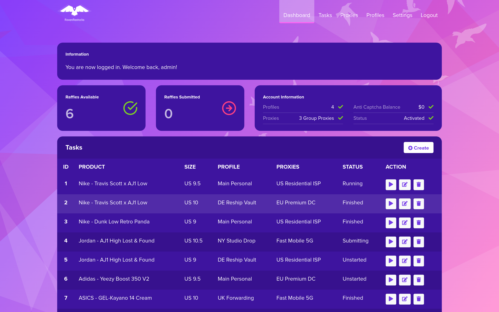
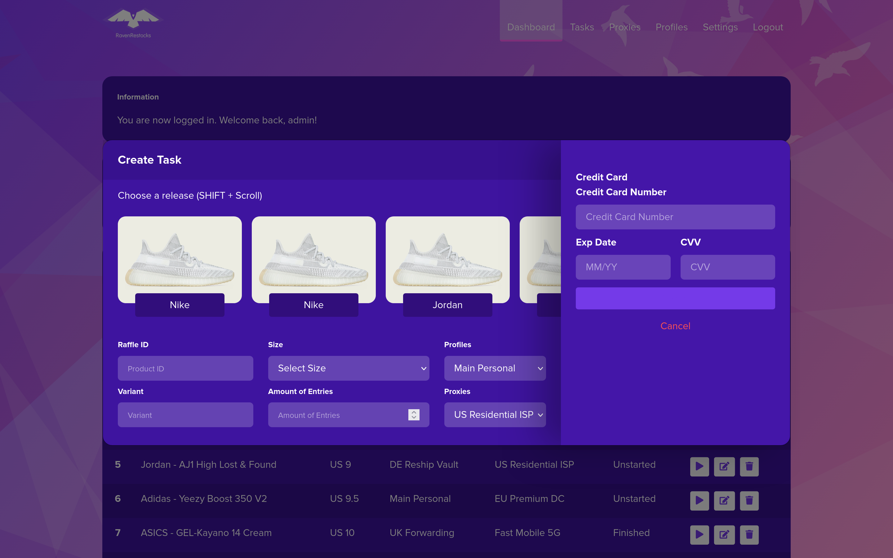
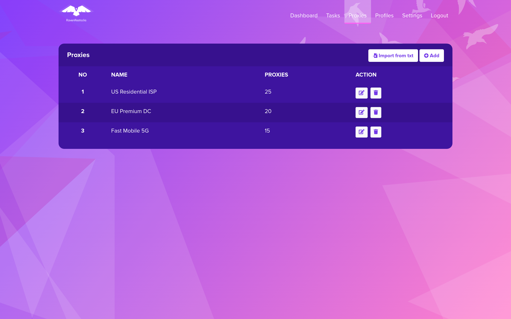
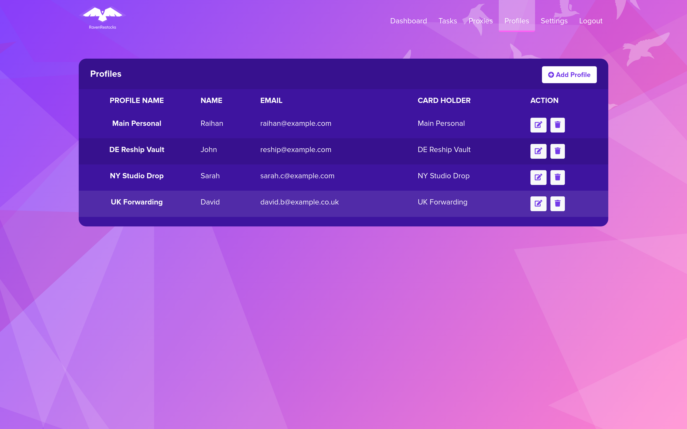

# Raffle Dashboard

A Flask web dashboard for sneaker raffle task management, proxy pools, and Discord webhook notifications.

> **Note**: This repository contains the **web dashboard interface only**. The underlying raffle automation engine and background task workers are proprietary software and are not included in this repository.

## Screenshots

| Dashboard Overview | Task Creation & Release Selection |
| :---: | :---: |
|  |  |
| **Proxy Pool Manager** | **Profiles & Billing** |
|  |  |

## Features

- **Raffle Overview**: Monitor available releases, active tasks, and status metrics.
- **Task Management**: Configure entry tasks, select sneaker sizes, and assign proxies/profiles.
- **Proxy Pool Manager**: Organize proxy groups and import proxy lists (`host:port:user:pass`).
- **Profile Manager**: Manage shipping details and billing profiles.
- **Discord Webhook Alerts**: Webhook notification payloads for task status updates.

## Quick Start

### 1. Installation

```bash
git clone https://github.com/RaihanStark/raffle-web-dashboard.git
cd raffle-web-dashboard

python3 -m venv venv
source venv/bin/activate
pip install -r requirements.txt
```

### 2. Database Setup

```bash
python manage.py recreate_db
python manage.py setup_dev
python manage.py add_fake_data
```

### 3. Run

```bash
python manage.py run
```

Open [http://localhost:5000](http://localhost:5000) and log in:
- **Username**: `admin`
- **Password**: `admin123`
